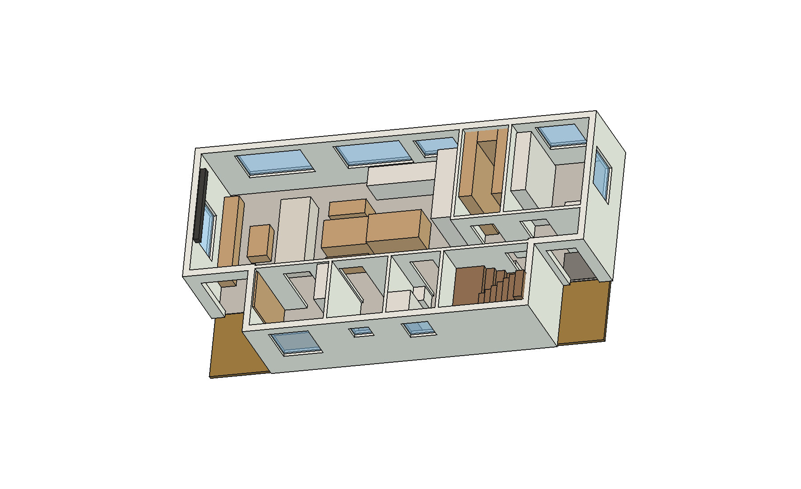
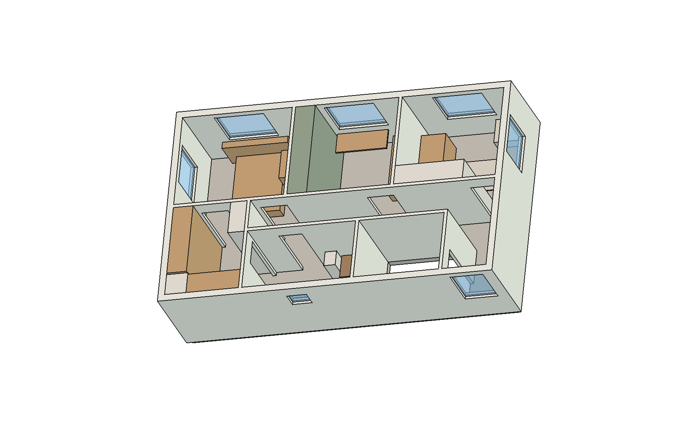

# Interiorismo japandi — casa Mariquina

Diseño interior de la vivienda: muebles, materiales, iluminación y domótica.
Planos: [lámina 10 — plantas amobladas](laminas/10_interiorismo.pdf) y [lámina 11 — iluminación y domótica](laminas/11_iluminacion_domotica.pdf).
Datos editables en [`interiorismo_datos.py`](interiorismo_datos.py). El modelo FreeCAD trae los muebles en los grupos `Interior_P1` e `Interior_P2`.

| Primer piso | Segundo piso |
|---|---|
|  |  |

> Anteproyecto de interiorismo. Las medidas son aproximadas: un mueblista debe medir en obra, con los tabiques ya terminados.
> Los costos son un **orden de magnitud a 2026**. Hay que cotizar con al menos 3 mueblistas.

---

## 1. Concepto

**Japandi** mezcla la calidez nórdica con la contención japonesa: madera clara, blanco cálido, un acento oscuro y muy pocos objetos a la vista.
En esta casa (125 m², 4 personas, 3 gatos y 1 perro), el estilo se apoya en cuatro reglas:

1. **Todo tiene un lugar cerrado.** Cada recinto tiene al menos un mueble que esconde algo: el proyector, la cama de invitados, el refrigerador, el arenero, el tablero eléctrico o la ropa sucia.
2. **Guardado de piso a cielo y sin tiradores.** Las puertas lisas se abren con push o con uñero. Así el mueble se lee como muro y la pieza se ve más grande. Bajo 1,20 m se usan trabas de niños.
3. **Madera nativa como hilo conductor.** La **lenga** (*Nothofagus pumilio*, con certificación FSC desde Aysén o Magallanes) va en mesa, bancos, camas, vanitorios y peldaños. Reemplaza al roble importado: es local, tiene un tono rosado claro muy japandi y es dura.
4. **La tecnología se ve sólo cuando se usa.** No hay televisor: un telón baja del cielo. La campana va integrada en la encimera. El rack está tras una puerta enrasada y los sensores son pequeños y blancos.

## 2. Materialidad

| Cód. | Material | Dónde | Por qué |
|---|---|---|---|
| LEN | Lenga aceitada (aceite-cera mate) | Muebles bajos, mesa, camas, peldaños | Madera nativa, cálida; el aceite se repara a mano si los gatos la rayan |
| FRE | HPL mate "lino blanco" antihuella | Cocina, columnas, clósets, cama abatible | Muro de guardado que "desaparece"; resiste la humedad |
| LIN | Lino lavado o tela *performance* | Sofá (funda removible), cortinas, cojines | Se lava; la tela performance resiste uñas y babas |
| PIE | Porcelanato símil caliza mate 60×120, R10 | Piso del 1er piso y de los baños | El mejor piso para piso radiante; uñas del perro; continuo sin cortes |
| PIO | Porcelanato piedra oscura texturada | Genkan y terrazas | Marca la entrada y oculta el barro |
| MAD | Porcelanato símil roble claro 20×120 | Dormitorios y pasillo del 2° piso | Aspecto de madera sin miedo al agua ni a las mascotas. Va sobre el **piso flotante acústico** (yeso-fibra sobre lámina antiimpacto) con adhesivo flexible |
| MUR | Pintura mineral "blanco arroz" antihongos | Muros y cielos | Blanco cálido (no azulado); clima de Los Ríos |
| NEG | Negro carbón mate | Grifería, rieles, manillas, telón | El acento gráfico del japandi |
| SAL | Verde salvia | Azulejo vertical de las duchas, clóset del dorm. 2, textiles | Un solo color de acento, apagado |
| TER | Pino termotratado | Ofuro, listones del cielo del baño | Aroma y textura de onsen, sin químicos |
| SHO | Panel efecto washi (policarbonato) | Puertas correderas del walk-in y la despensa | Luz difusa tipo shoji; **el papel real no resiste a los gatos** |
| FIE | Fieltro PET reciclado antracita | Detrás de los listones de lenga | Acústica de las videollamadas y del living |

**Paleta:** blanco arroz `#EEE9E0` · lino `#D9D0C1` · caliza `#CFC7BA` · lenga `#C49A6C` · salvia `#8E9B86` · carbón `#33312E`.
Regla 70/20/10: 70 % blancos y cálidos, 20 % madera y 10 % carbón o salvia.

## 3. Recinto por recinto

### Living–comedor–cocina (32 m²)
- **Living:**
  - **L1 · Banco bajo la ventana oeste** de 2,7 m con cajones. Dentro va un proyector láser de tiro ultracorto que sube con la escena *Cine*.
  - En el extremo sur del banco hay un **nicho-cama para el perro**.
  - **L2 · Telón de 100"** en un cajón del cielo: baja frente a la ventana y no hay televisor negro dominando la pieza.
  - **L3 · Sofá bajo** con funda lavable, de espaldas al comedor; separa los ambientes sin muros.
  - **L4 · Mesa de centro elevable:** sube a altura de trabajo.
- **Comedor:**
  - **C1 · Mesa maciza** de lenga, adosada a la isla, con alas ocultas (de 6 a 8 personas).
  - **C2 · Banco-baúl** al sur, para 3 personas.
- **Cocina:**
  - **K1 · Cocina lineal norte, sin muebles altos.** Las ventanas mandan.
    - Inducción con **extractor integrado en la encimera**: no hay campana.
    - Lavavajillas panelado y reciclaje en 4 fracciones (incluido el compost, útil en terreno rural).
  - **K2 · Muro de columnas de piso a cielo:** refrigerador panelado, horno y microondas, despensero extraíble, y un **"garaje" de electrodomésticos** con puertas escamoteables donde viven la cafetera, el hervidor y la tostadora.
  - **K3 · Isla de lenga** con el **comedero del perro en un cajón del zócalo**.
- **Pasos:** 0,95–1,08 m en la cocina y 0,90 m al sur del comedor.

### Entrada (genkan) y escalera
- **G1 · Genkan:** porcelanato oscuro y felpudo embutido, **sin desnivel** para el coche de la bebé. El cambio de piso marca dónde quedan los zapatos.
- **G3 · Zapatero basculante de 20 cm**, flotante y con LED bajo el mueble. Es delgado porque el pasillo mide 0,90 m.
- **G4 · Ganchos abatibles** al ras del muro: abrigos, correa del perro y llaves.
- **G2 · Armario técnico embutido:**
  - Toma un nicho de 0,30 m de la oficina 2 y se abre desde el pasillo.
  - Contiene el tablero TDA, el rack, Home Assistant, la ONT y el switch PoE, tras una puerta enrasada con rejilla.
  - Puerta sin llave, para cumplir el acceso libre al tablero.
- **Escalera helicoidal Ø 1,80 m** (lámina ESC-01): se entra de frente desde el pasillo. Lleva peldaños de lenga, pilar y barrotes negro carbón, y LED bajo el borde de cada peldaño. Usa poco espacio y libera una franja de 0,80 m en cada piso.
- **Guardado oculto bajo la helicoidal (~1,8 m³):**
  - Un tambor de listones verticales de lenga cierra el espacio bajo los peldaños 3 a 11, siguiendo el borde de cada uno.
  - Las puertas se cortan en el mismo listonado, con bisagra oculta y cierre push, sin tiradores: no se distingue dónde están.
  - Además, la bebé no puede meterse bajo la escalera.
  - **E4 · Clóset cuña** (bajo los peldaños 10–11, hasta 1,9 m de alto). Se abre hacia la entrada: abrigos de temporada, el coche plegable de la bebé, paraguas y bolsos.
  - **E5 · Bodega** (bajo los peldaños 7–9). Se abre desde la sala técnica por una puerta de 0,50 × 1,20 m: maletas, cuna de viaje y cajas de temporada.
  - **E6 · Baúles** (bajo los peldaños 3–6). Las huellas se levantan con pistón y traba de niños: pilas, linternas, herramientas y juguetes que rotan.
- **Sala técnica** (P1, en esa franja, con puerta desde la lavandería): batería e inversor, y además:
  - **E2 · Mueble bajo** con el arenero de los gatos (extracción VMC) y la base de la aspiradora robot, junto a la batería; deja libre la puerta de E5.
- **Puertas de seguridad** arriba y abajo, con sensor: la domótica avisa si quedan abiertas.

### Oficinas
- **Oficina 1:**
  - **O1 · Escritorio flotante bajo la ventana**, con la luz de frente para las videollamadas y bandeja pasacables.
  - **O2 · Guardado de piso a cielo**, con la impresora en una bandeja extraíble.
  - **O3 · Muro de listones** de lenga sobre fieltro, que corta el eco.
  - Queda **convertible en dormitorio de primer piso** a futuro (ver el manual, §2.1).
- **Oficina 2:**
  - **O4 · Cama abatible horizontal de 140** con escritorio integrado: es la pieza de invitados cuando hace falta.
  - Con la cama abierta quedan 0,45 m libres hacia el muro este. Es justo, pero suficiente para alojar visitas.

### Lavandería, bodega y baño del 1er piso
- **V1 · Columna** con lavadora y secadora **con bomba de calor** (no necesita ducto), apiladas tras puertas.
- **V2 · Lavadero bajo tapa:** cerrado es mesón para doblar ropa. Encima va un **tendedero de techo con poleas**.
- **Puerta de la sala técnica con gatera de microchip:** solo los gatos entran al arenero; el perro no.
- **V4 · Canasto** donde cae el **ducto de ropa sucia** (B6) que baja desde el baño del 2° piso.
- **B1, B2:** vanitorio flotante, WC suspendido con **estanque dentro del tabique** y espejo-botiquín embutido.
  - Ducha a ras de piso con desagüe lineal y teléfono a 0,50 m para bañar al perro.

### Dormitorio principal y walk-in
- **P1 · Cama plataforma baja** de 150×190 con 4 cajones grandes.
- **P2 · Cabecero-repisa bajo la ventana norte**, con LED indirecto, veladores flotantes y cargadores ocultos.
  - La cama queda enmarcada por la ventana, con 0,90 m libres a cada lado.
- **P3 · Cuna colecho** el primer año. Luego pasa al dormitorio 3.
- **Walk-in closet:**
  - **W1** esconde el recuperador VMC tras puertas con rejilla.
  - **W2 y W3:** barras a 1,00 y 1,65 m (estatura 1,64 m), cajonera y caja fuerte.
  - **W4:** la ropa blanca de toda la casa.
  - La puerta del dormitorio al walk-in pasa a ser **corredera embutida (SHO)**: libera el giro.

### Dormitorio 2 (hija de 12 años)
- **A1 · Clóset de muro completo** en verde salvia, con barras a 1,40 y 1,65 m que crecen con ella.
  - Queda entre su pieza y la de los papás y hace de **colchón acústico**.
- **A2 · Cama nido:** una segunda cama extraíble para pijamadas.
- **A3 · Escritorio bajo la ventana** con tablero de clavijas, para que decore sin perforar muros.
- El centro queda libre, de 1,6 × 2,2 m.

### Dormitorio 3 (bebé, crece con ella)
- **N1 · Clóset con repisas regulables:** pañales hoy, barra y cajones mañana.
- **N2 · Cómoda-mudador**, a la que se le saca la bandeja.
- **N3 · Cuna convertible en cama junior**, **lejos de la ventana**.
- **N4 · Sillón de lactancia** y **N5 · tatami de juego** al centro.

### Baño del 2° piso y hall
- **B3 · Vanitorio doble flotante.**
- **B4 · Zona húmeda japonesa:** ducha y **ofuro** de 110×70×60 en un mismo recinto con piso continuo y mampara fija.
  - El ofuro sirve para bañar a los niños y para el ritual de la tarde.
- **B6 · Ducto de ropa sucia** a la lavandería: sección de 30×30, tapa con traba y una sola pasada por la losa.
- **E3 · Ropería** (P2, en la franja que libera la helicoidal, con puerta desde el pasillo): repisas de 35 cm de piso a cielo para ropa de cama, toallas y pañales. Al lado quedan maletas, la cuna de viaje y la aspiradora del 2° piso.
- **H1 · Banco-biblioteca en el hall**, un rincón de lectura junto a la ventana sur que no estorba la llegada de la escalera.

## 4. Iluminación
- **Luz indirecta en vez de plafones:**
  - LED en fosa de cielo en el living;
  - en el cabecero;
  - bajo el zapatero;
  - en el zócalo de la isla.
- Los centros de la [lámina 02](laminas/02_electrico.pdf) se mantienen (RIC) como luz general.
- **Blanco dinámico 2700–4000 K:** cálido en la tarde y neutro al trabajar.
- **De noche, guía ámbar al 5 %** por presencia en el pasillo del 2° piso, los peldaños y el zócalo. No despierta a la bebé y no cruza la casa con luz blanca.
- Lámparas: papel tipo Akari, ratán o lino. Nada de cristal colgante a la altura de los gatos.

## 5. Domótica

**Arquitectura:**
- **Home Assistant local** en el armario técnico G2, con UPS. Funciona sin internet.
- **Zigbee 3.0 y Thread/Matter** para los sensores, sin depender de una marca.
- Se **conservan los interruptores** físicos, con micromódulos detrás. Cumple RIC y cualquiera puede apagar la luz.
- **Cat6** a cada recinto y **PoE** para el videoportero y las cámaras.

**Equipos** (detalle en la lámina 11):
- presencia mmWave por recinto;
- sensor ambiente (T°, HR y CO₂) por zona de piso radiante;
- 6 sensores de fuga con válvula general motorizada;
- cerradura digital;
- contactos en las puertas de seguridad;
- monitor de bebé local;
- motor del telón;
- gatera de microchip;
- cortinas motorizadas **a batería y sin cordones**.

**Escenas:**

| Escena | Disparador | Qué hace |
|---|---|---|
| Buenos días | Alarma del celular | Cortinas suben; el cabecero pasa de 30 % a 100 % en 15 min |
| Cine | Botonera del living | Baja el telón, sube el proyector, cierra las cortinas, fosa LED al 10 % |
| Siesta bebé | Botón en el dormitorio 3 | Timbre en silencio, pasillo ámbar, VMC en modo bajo |
| Llegada | Cerradura abre con huella | Luz del genkan y del zapatero, clima a confort, aviso de puerta de seguridad |
| Salir | Botonera de la entrada | Apaga todo, baja 2 °C, deja los sensores en guardia |
| Noche | 23:00 o botón del cabecero | Guía ámbar por presencia |
| Sol a favor | Excedente FV > 2 kW | Secadora, lavavajillas, ACS a 60 °C y auto |
| Fuga | Cualquier sensor FU | Cierra la válvula general y avisa |

Las escenas *Sol a favor* y del piso radiante conectan con la bomba de calor (SG-Ready) y el inversor híbrido ya proyectados.

## 6. Cambios que hay que coordinar con los otros proyectos

Estos cambios **no** se hicieron todavía en `casa_datos.py` ni en `instalaciones_datos.py`, para no alterar el cálculo estructural.
Hay que pasarlos al arquitecto, al instalador eléctrico y al proyectista sanitario:

1. **Nicho G2** de 0,60 × 0,30 m en el tabique pasillo/oficina 2. El **TDA y el rack se trasladan** de la cara del pasillo al nicho, a ~0,3 m de su posición actual.
2. **Escalera helicoidal** (ya en `casa_datos.py`): la puerta de 0,60 m de la sala técnica reemplaza la antigua escotilla. Hay que pasarle al calculista:
   - el pilar de acero anclado al radier (carga puntual: dado de fundación bajo el pilar);
   - el hueco del entrepiso, que ahora es de 1,80 × 1,90 m, con el descanso de llegada en voladizo;
   - el tabique nuevo en x 8,60.
3. **Ducto B6** de 0,30 × 0,30 m por la losa, entre el baño del 2° piso y la lavandería.
4. **Ofuro en el baño del 2° piso:** desagüe de Ø50 a la bajada existente. El agua caliente viene del acumulador de 300 L: un ofuro de 400 L con 45 % de agua caliente gasta ~180 L, así que hay que programarlo fuera de las duchas.
5. **Puntos eléctricos nuevos:**
   - proyector en el banco L1, y telón y cortinas en el cajón del cielo;
   - fosas LED con su fuente;
   - enchufe en el cabecero;
   - base del robot en E2 (sala técnica) y gatera;
   - extracción VMC de la sala técnica, para el arenero (ya en ELE/VEN).
6. **Puerta del walk-in:** pasa de abatible a corredera embutida (marco tipo casete).
7. **Fijación de todos los muebles altos al muro** (sismo y niños). Hay que dejar refuerzos de madera dentro de los tabiques **antes de cerrar el yeso-cartón**.
8. **Cielo del 1er piso a 2,36 m** (antes 2,50) por el entrepiso acústico. Ya se ajustaron los muebles de piso a cielo:
   - K2 (columnas de cocina), O2, V1 y el panel O3;
   - el cajón del telón L2.

   Hay que cotizarlos con esa altura.
9. **Ventiloconvectores del 2° piso** (consola baja, ~0,9 × 0,2 m), ubicados donde no chocan con los muebles:
   - dormitorio principal: bajo la ventana oeste;
   - dormitorio 2: muro sur, entre el clóset A1 y la puerta;
   - dormitorio 3: bajo la ventana norte, lejos de la cuna N3.

   No taparlos con muebles ni cortinas largas.
10. **Nicho G2:** ahora debe recibir también el **TDA-R** (subtablero de respaldo), así que pasa de 0,60 a ~0,90 m de ancho.
11. **Zócalos del 2° piso separados del piso** (el piso flota): se pegan sólo al muro y el encuentro se sella con sello flexible.

## 7. Presupuesto y etapas (orden de magnitud, CLP 2026)

| Etapa | Qué | Referencial |
|---|---|---|
| Obra gruesa | Refuerzos en tabiques, Cat6, ducto B6, nicho G2, cajas profundas | 0,5–0,8 MM |
| Para mudarse | Cocina K1–K3 y clósets A1, N1, W2–W4 en HPL; puertas de baño | 5–8 MM |
| Primer año | Mesa y banco de lenga, cama plataforma, Home Assistant, cerradura, fugas | 2–3,5 MM |
| Con capital | Cama abatible, kaidan-dansu, banco L1, telón + proyector, cortinas motorizadas, ofuro, LED | 5–9 MM |

**Cómo bajar costos sin perder el estilo:**
- Hacer los clósets en melamina texturada "lino" (en vez de HPL) y dejar la lenga sólo donde se toca: mesa, cubierta de la isla y peldaños.
- Instalar las cortinas motorizadas por etapas, empezando por los dormitorios.
- Comprar el proyector cuando la bebé tenga 2–3 años: ahí tiene más sentido.

## 8. Mantención
- **Lenga:** aceite-cera una vez al año. Los rasguños de los gatos se lijan suave y se re-aceitan en el lugar.
- **HPL:** paño húmedo. No usar cloro.
- **Porcelanato:** sin productos con cera, que se ponen resbalosos con el piso radiante.
- **Filtros VMC:** se cambian cada 6 meses (aviso automático en Home Assistant).
- **Arenero (sala técnica):** la extracción VMC corre continua en bajo y sube por presencia.
