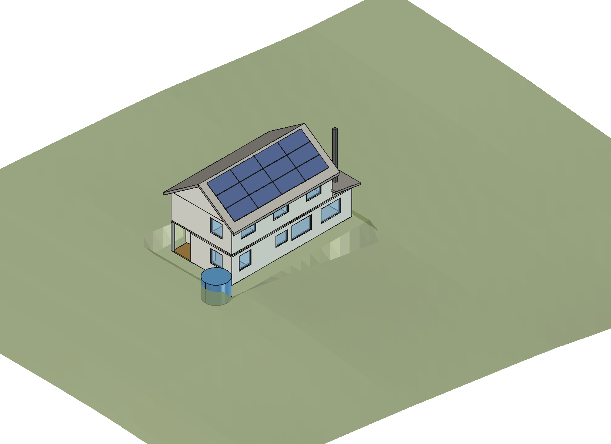

# Casa FreeCAD — vivienda 2 pisos en Mariquina (Los Ríos, Chile)

Proyecto de **aprendizaje de FreeCAD**: una vivienda de 2 pisos (P1 12 × 6 m, P2 10 × 6 m) diseñada completa por código,
con datos reales del sitio (clima 1995–2025, sol, topografía, normativa chilena).



## Contenido

- **Modelo FreeCAD** [`Casa.FCStd`](Casa.FCStd): 3D (muros, techo 35°, paneles FV, terreno) + capas de instalaciones.
- **9 láminas A3** en [`laminas/PLANOS_COMPLETOS.pdf`](laminas/PLANOS_COMPLETOS.pdf):
  - arquitectura, eléctrico y gasfitería;
  - emplazamiento y techumbre FV;
  - ventilación, elevaciones, estructura y topografía.
- **Memorias de cálculo** en [`calculo/MEMORIAS.pdf`](calculo/MEMORIAS.pdf): estructural (NCh433, con verificación FEM en CalculiX), condensación (Glaser), FV + batería (simulación horaria) y topografía.
- **Sitio** en [`sitio/INFORME_SITIO.md`](sitio/INFORME_SITIO.md): clima, sol, viento y normativa aplicable.
- **Manual de construcción por etapas** en [`MANUAL_CONSTRUCCION.md`](MANUAL_CONSTRUCCION.md).

Guía de uso y de FreeCAD: [`LEEME.md`](LEEME.md).

## Regenerar

```bash
python3 generar_laminas.py                 # láminas SVG/PDF
python3 -I calculo/estructura.py           # y condensacion.py, fv_bateria.py
python3 -I calculo/generar_memorias.py     # memorias PDF (usa Chrome headless)
```

Modelo 3D: en la consola Python de FreeCAD, `exec(open("construir_instalaciones.py").read())`. Requiere `rsvg-convert`.

> ⚠️ **Anteproyecto académico.** Medidas aproximadas, suelo y topografía estimados (DEM ~30 m). No reemplaza los proyectos firmados
> por arquitecto, calculista ni instaladores SEC.
